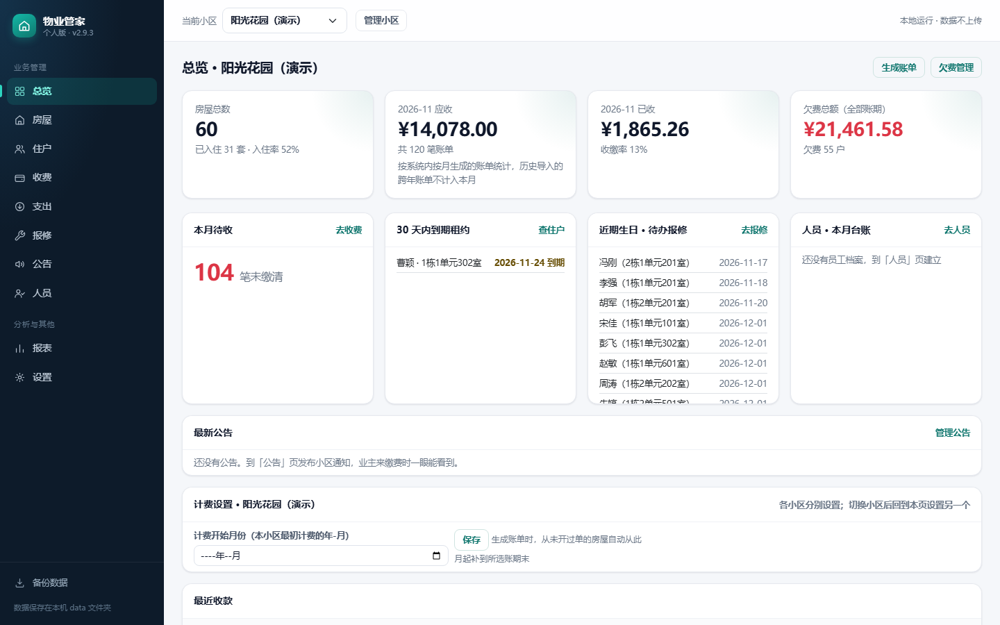
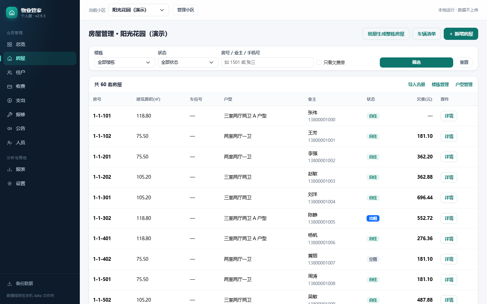
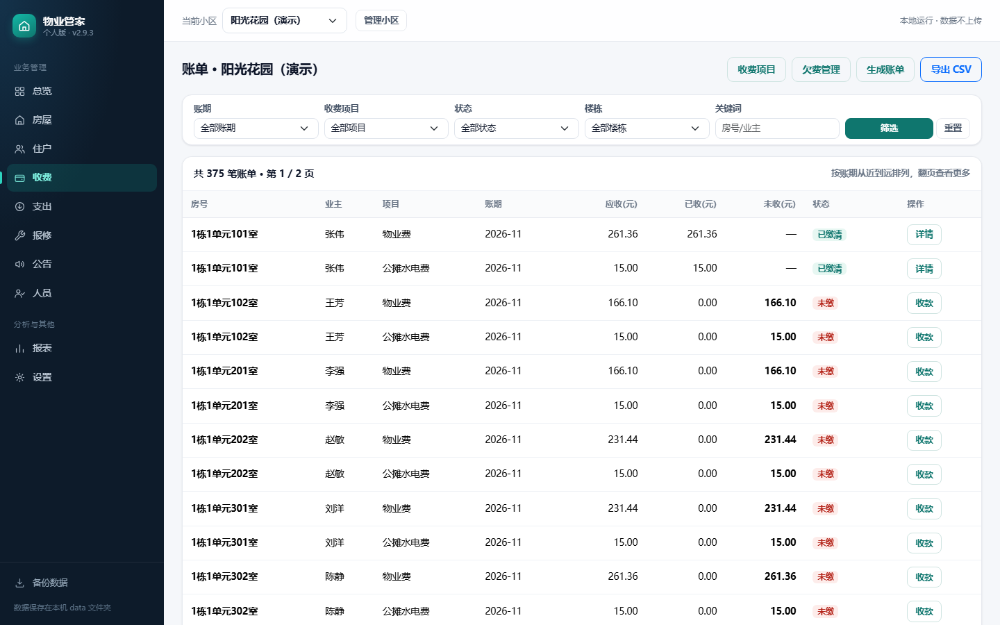
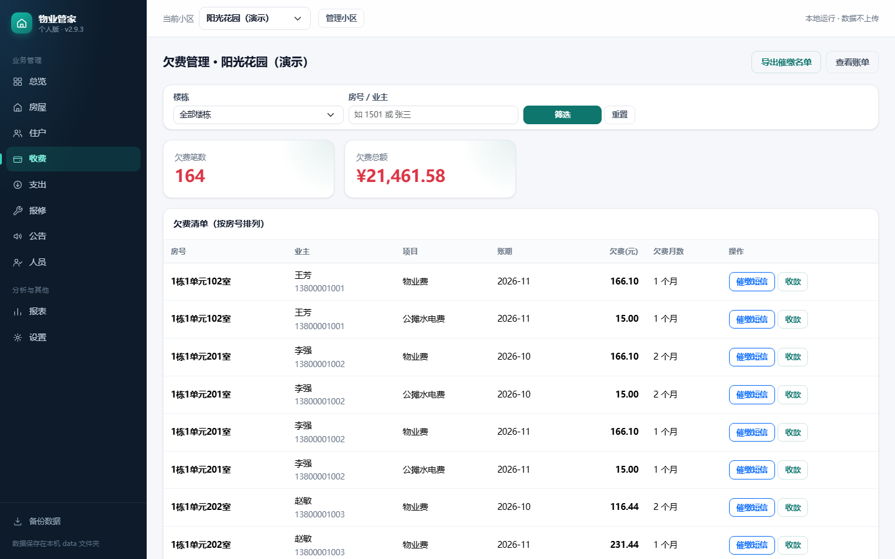
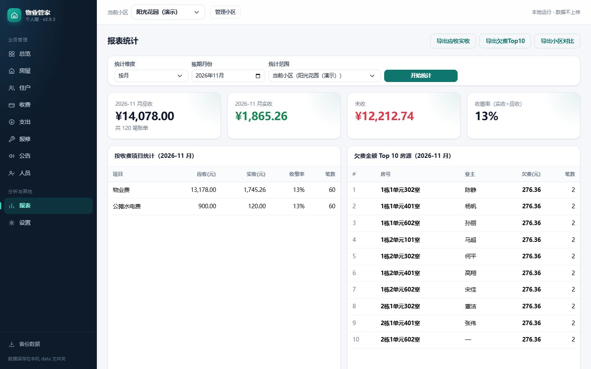
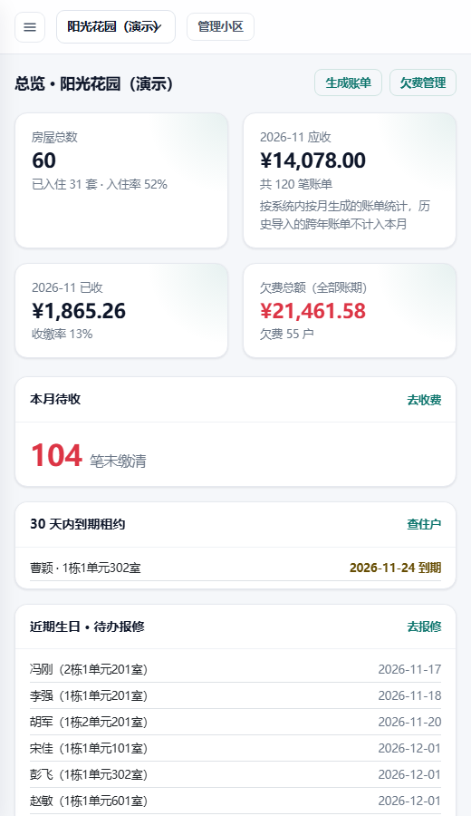

# 物业管家 · 小区物业管理系统

一套基于 **Python Flask + SQLite** 的本地化小区物业管理系统，覆盖小区与楼栋台账、房屋住户档案、物业费账单生成与收缴、欠费催缴、报修派单、员工工资社保、公共支出、公告发布、报表统计等日常业务。前后端不分离，服务启动后用浏览器即可使用，无需安装数据库、无需联网。

- 项目来源：开源项目 [BFwmds330/property-management](https://github.com/BFwmds330/property-management)（个人版 v2.9.3）
- 本仓库在该版本基础上完成了**界面整体重构**（左侧导航 + 卡片式仪表盘 + 统一设计规范），并补充了部署与使用说明，用于《软件工程》课程实验。

## 一、技术栈

| 层次 | 技术选型 |
| --- | --- |
| 后端语言 | Python 3.10+ |
| Web 框架 | Flask 3.x（蓝图 Blueprint 分模块组织路由） |
| 数据库 | SQLite 3（Python 标准库 `sqlite3`，单文件存储） |
| 模板引擎 | Jinja2 |
| 前端 | Bootstrap 5（已本地化，离线可用）+ 原生 CSS/JS，无 npm 构建 |
| 架构 | 三层结构：路由层 `routes/` → 业务层 `services/` → 数据层 `database.py` |

## 二、功能模块

系统按业务划分为 10 个模块，其中前 8 个可作为需求分析中的核心用例：

| 编号 | 功能模块 | 主要功能点 |
| --- | --- | --- |
| F1 | 小区管理 | 新建 / 编辑 / 删除小区，多小区切换，计费起始月份设置 |
| F2 | 楼栋与房屋管理 | 楼栋维护、批量生成整栋房屋、房屋新增 / 编辑 / 过户、户型与车辆登记、名册导入 |
| F3 | 住户管理 | 住户档案登记、按姓名 / 房号 / 手机号检索、业主与租户关系维护、生日与租约到期提醒 |
| F4 | 收费管理 | 收费项目配置、按月批量生成账单、账单收款 / 调整 / 作废、收据打印、预收款管理 |
| F5 | 欠费管理 | 欠费房屋汇总、按楼栋筛选、一键催缴短信生成、欠费清单导出 |
| F6 | 报修管理 | 住户报修登记、派单与处理状态跟踪、报修照片上传、完成情况统计 |
| F7 | 公告管理 | 发布 / 编辑 / 置顶 / 删除小区公告，首页展示最新公告 |
| F8 | 报表统计 | 应收实收汇总、按收费项目统计、欠费 Top10、各小区收缴率对比、CSV 导出 |
| F9 | 人员与支出 | 员工档案、工资与社保批量录入、合同到期提醒、公共支出登记与导出 |
| F10 | 系统设置 | 数据备份与恢复、演示数据载入 / 清空、启动密码、操作日志查询 |

> 若按实验要求选取 6～8 个用例，可合并为：**小区管理、房屋管理、住户管理、收费管理、欠费催缴、报修管理、公告管理、报表统计**。

## 三、系统角色与利益相关方

| 角色 | 职责与关注点 |
| --- | --- |
| 物业管理员（系统主要使用者） | 维护台账、生成账单、办理收款、处理报修、发布公告、查看报表 |
| 住户 / 业主 | 按时缴费、提交报修、查看公告，关心账单准确性与响应速度 |
| 财务人员 | 关心收款流水、支出记录、报表口径与导出数据的准确性 |
| 物业公司管理层 | 关心收缴率、欠费规模、各小区经营对比 |
| 系统维护人员 | 关心数据备份与恢复、运行环境依赖、故障排查成本 |

## 四、数据模型（核心表）

数据库文件为 `data/property.db`，共 20 张表，核心实体如下：

| 表名 | 说明 | 关键字段 |
| --- | --- | --- |
| `community` | 小区 | `id`、`name`、`billing_start`、`is_demo` |
| `building` | 楼栋 | `id`、`community_id`、`code`、`unit_count` |
| `house` | 房屋 | `id`、`community_id`、`building_id`、`unit`、`room_no`、`area`、`status` |
| `resident` | 住户 | `id`、`name`、`phone`、`id_card`、`birthday` |
| `resident_house` | 住户与房屋关系 | `resident_id`、`house_id`、`role`、`lease_end` |
| `fee_item` | 收费项目 | `id`、`name`、`unit_price`、`calc_type` |
| `bill` | 账单 | `id`、`house_id`、`fee_item_id`、`period`、`amount`、`status` |
| `payment` | 收款流水 | `id`、`bill_id`、`amount`、`pay_date`、`method` |
| `repair` | 报修单 | `id`、`house_id`、`content`、`status`、`created_at` |
| `staff` | 员工 | `id`、`name`、`department`、`contract_end` |

实体关系：一个小区包含多栋楼，一栋楼包含多套房屋；一套房屋可关联多名住户（业主 / 家属 / 租户）；一套房屋产生多条账单，一条账单对应多条收款记录；房屋与报修单是一对多关系。

金额统一以「分」为整数存储，面积以 0.01 ㎡ 为整数存储，避免浮点误差。

## 五、目录结构

```
项目源码/
├── app.py                   应用入口（建库、选端口、启动服务）
├── config.py                配置（路径、端口、上传大小）
├── database.py              数据库连接与建表
├── utils.py                 校验工具（手机号、身份证、金额、账期）
├── requirements.txt         Python 依赖
├── 启动.bat                 Windows 一键启动
├── 手机访问.bat             局域网访问模式
├── routes/                  路由层，按业务模块拆分（13 个蓝图）
├── services/                业务逻辑层
├── templates/               Jinja2 模板（32 个页面）
│   ├── base.html            公共布局：左侧导航 + 顶栏
│   ├── dashboard.html       总览仪表盘
│   ├── house/ resident/ fee/ expense/ staff/ repair/ notice/ report/ community/ system/
├── static/
│   ├── css/style.css        设计规范与组件样式
│   ├── js/main.js           交互脚本（确认弹窗、短信生成等）
│   └── vendor/              Bootstrap 5（本地化）
├── docs/
│   ├── 设计说明.md          原项目设计文档
│   └── screenshots/         界面截图
├── tests/smoke_test.py      自动化冒烟测试
└── data/                    数据库与备份（首次运行自动创建）
```

## 六、运行方式

### 方式一：一键启动（Windows）

双击项目根目录的 `启动.bat`，脚本会自动检测 Python、安装依赖、启动服务并打开浏览器。

### 方式二：手动启动

```bash
# 1. 创建并激活虚拟环境
python -m venv .venv
.venv\Scripts\activate            # Windows
# source .venv/bin/activate       # macOS / Linux

# 2. 安装依赖（只有 Flask 一个第三方库）
pip install -r requirements.txt

# 3. 启动
python app.py
```

浏览器访问 <http://127.0.0.1:5000/>（端口被占用时会自动顺延到 5001～5010）。

### 载入演示数据

首次启动数据库为空，会引导创建小区。若只想快速查看效果，进入「设置 → 演示数据 → 载入演示数据」，系统会自动生成 2 个小区、72 套房、62 位住户、381 笔账单、216 条收款记录，可随时一键清空。

## 七、界面预览

| 总览仪表盘 | 房屋台账 |
| --- | --- |
|  |  |

| 账单与收款 | 欠费催缴 |
| --- | --- |
|  |  |

| 报表统计 | 窄屏（手机）效果 |
| --- | --- |
|  |  |

## 八、说明

- 服务默认只监听 `127.0.0.1`，仅供本机使用；需要手机访问时运行 `手机访问.bat`（同一 WiFi 下）。
- 所有数据保存在 `data/` 目录，删除该目录即恢复出厂状态；建议定期在「设置」中备份。
- 本仓库仅用于课程学习与实验演示，原始项目版权归原作者所有。
